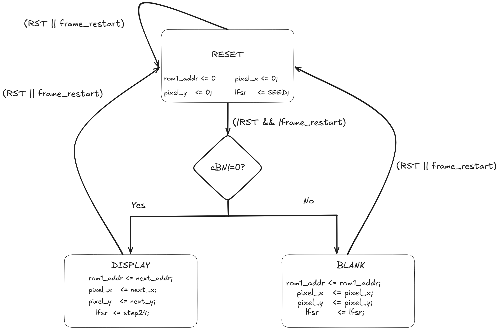
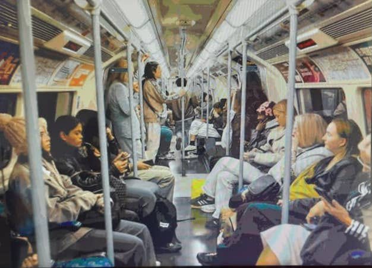
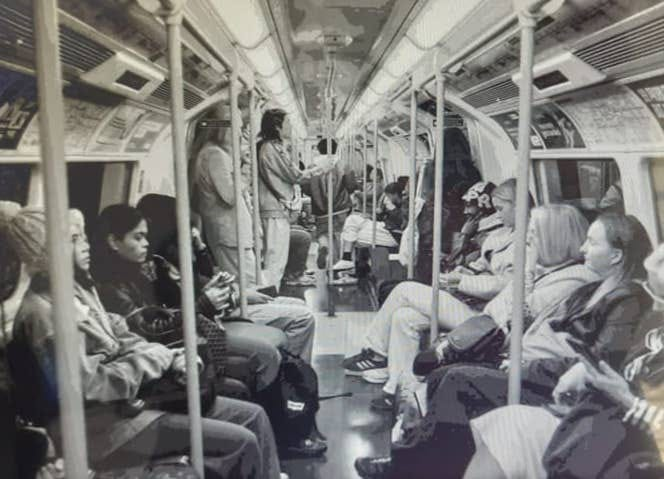
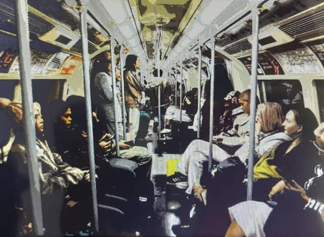
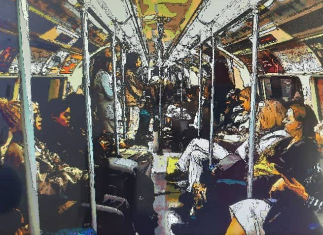

# Secure Image Processing Pipeline on Intel Cyclone V FPGA

Real-time, pipelined image processing SoC architecture featuring hardware acceleration for spatial and color transformations, protected by an inline cryptographic stream cipher. This project targets the **Intel Cyclone V SoC FPGA (5CSEMA5F31C6)** on the Terasic DE1-SoC board, utilizing a cycle-accurate verification and implementation framework to profile real-world silicon parameters.

## Core Features
*   **Parallel Multi-Filter Array:** Concurrent hardware execution of four operational pipelines: Bypass (`2'b00`), Grayscale (`2'b01`), High Contrast (`2'b10`), and Cartoonizer with a custom Roberts Cross spatial edge detection core (`2'b11`).
*   **Inline Cryptographic Gating:** Pipelined stream cipher engine executing dynamic data obfuscation via a 24-step Linear Feedback Shift Register (LFSR) with user-controlled execution gating.
*   **Synchronous Frame Management:** Integrated 25 MHz VGA video sync signal engine implementing a deterministic, hazard-free Algorithmic State Machine with Data (ASMD) architecture to govern streaming registers.

---

## RTL Microarchitecture & Data Path

The system separates concerns into a pipelined Data Path for streaming pixels and a synchronous Control Path to eliminate timing and data hazards.


*   **Blue Path (Streaming Data Path):** Coordinates a 19-bit address engine through a cascaded ROM arrangement (`img_index` to `img_data`) to yield 24-bit raw RGB streams. Data broadcasts concurrently to all computing filters before entering a combinational 4-to-1 multiplexer governed by the user `OPCODE`. The selected vector passes through an inline XOR layer driven by the active LFSR cipher state before hitting the physical VGA pin interfaces.
*   **Red Path (Synchronous Control Path):** Mapped to a centralized controller monitoring user input lines against history tracking registers to generate clean, synchronous `frame_restart` clear pulses. Coordinates with the VGA Sync Generator to handle blanking intervals and sync pulses without corrupting internal arithmetic states.

---

## Algorithmic State Machine with Data (ASMD)

The system enforces frame-level synchronization using a deterministic, 3-state ASMD engine bound tightly to the active video raster scanning regions.



*   **RESET State (`STATE 0`):** Asserts dynamically on global `RST` or when input edge-detection registers register a mode swap (`frame_restart = 1`). Automatically flushes memory pointers to zero, clears coordinate registers, and re-seeds the cryptographic engine back to `24'hACE15B`.
*   **DISPLAY State (`STATE 1`):** Active exclusively when `cBN != 0` (Active visual raster field). Increments `rom1_addr` sequentially up to 307,199 on every active 25 MHz edge and steps the LFSR tracking bits cycle-by-cycle.
*   **BLANK State (`STATE 2`):** Active during horizontal and vertical blanking porches (`cBN == 0`). Freezes all address and coordinate tracking registers, holding arithmetic blocks in a non-switching state to eliminate unnecessary dynamic power dissipation.

---

## Implementation & Synthesis Metrics

### 1. Fitter Physical Resource Utilization
The architecture represents a hardware-dense deployment, saturating **76% of the entire block memory fabric** on the Cyclone V chip to buffer uncompressed pixel matrices natively.

| Hardware Resource Layer | Actual Design Usage | Total Available on Chip | Device Percentage (%) | Primary Architectural Cause |
| :--- | :--- | :--- | :--- | :--- |
| **M10K Memory Blocks** | **301 Blocks** | 397 Blocks | **76%** | Synchronous dual-port storage for 2,463,744 bits of image array data. |
| **Dedicated Logic Registers** | **5,539 Registers** | 64,140 Registers | **8%** | Deep pipeline delay synchronization trees and Roberts Cross line-buffers. |
| **Logic Utilization (ALMs)** | **3,045 ALMs** | 32,070 ALMs | **9%** | Multi-bit barrel shifters, mux routing blocks, and gradient calculation trees. |
| **Total DSP Blocks** | **9 Blocks** | 87 Blocks | **10%** | Hard silicon macrocells executing pipelined filter multipliers (`*77`, `*150`, `*29`). |
| **Total User I/O Pins** | **34 Pins** | 457 Pins | **7%** | Clock inputs and high-speed physical 24-bit VGA output signal routing. |

### 2. TimeQuest Static Timing Analysis (STA)
Timing closure successfully resolved across all operational boundaries under worst-case parameters (**Slow 1100mV 85°C Silicon Junction Corner**), validating a maximum combinational propagation latency of **19.564 ns** along the High-Contrast multiplier path.

| Timing Parameter Metric | Report Value | Design Margin / Verification Status |
| :--- | :--- | :--- |
| **Worst-Case Setup Slack** | **`+20.436 ns`** | Timing Closed; Total Negative Slack (TNS) = 0.000. |
| **Worst-Case Hold Slack** | **`+0.295 ns`** | Safe; Eliminates clock-tree race condition hazards. |
| **Worst-Case Recovery Slack** | **`+33.501 ns`** | Safe; Asynchronous controls clear cleanly before active edges. |
| **Worst-Case Removal Slack** | **`+3.531 ns`** | Safe; Reset assertions remain stable long enough to register. |
| **Max Operating Frequency ($F_{\text{max}}$)** | **`51.11 MHz`** | Proves a **106% frequency margin** over the target 25 MHz VGA clock. |
| **Synchronizer Topography** | **`72 Chains`** | 2-Register minimum hardware topology detected within IP blocks. |
| **Worst-Case Settling Time ($T_{\text{s}}$)** | **`75.589 ns`** | Provides robust protection against system metastability. |

### 3. VCD-Driven Thermal Power Profiling
To achieve maximum accuracy, static vectorless activity estimation was disabled. Signal transition densities were extracted past the video blanking porches via a 1 ps master-grid Value Change Dump (`.vcd`) trace, yielding an average design density of **3.079 million transitions/second**.

| Silicon Sub-System Component | Active Power (mW) | Percentage of Dynamic (%) | Primary Operational Cause |
| :--- | :--- | :--- | :--- |
| **M10K Block Memory** | **17.53 mW** | **63.2%** | Constant dual-port block RAM port clock switching during pixel fetches. |
| **Design Registers** | **6.92 mW** | **24.9%** | Pipelined delay buffers (`gs_delay`, `hc_delay`, `cartoon_delay`, `dff_mux`). |
| **DSP Blocks** | **2.04 mW** | **7.4%** | Pipelined multiply-accumulate macrocell logic executing luminance math. |
| **Routing / ALM Fabric** | **1.26 mW** | **4.5%** | Combinational boolean networks evaluating mux options and Roberts Cross paths. |
| **Core Static Thermal Power** | **424.31 mW** | *(Static Baseline)* | Transistor leakage current inherent across the Cyclone V die substrate floorplan. |
| **Total Thermal Power Estimate** | **484.26 mW** | **100.0%** | Comprehensive active thermal dissipation boundary for the hardware system. |

---

## Verification & Simulation Automation

A custom Tcl script (`run_sim.do`) is provided to automate library mapping, organize sequential compilation variables for the structural Verilog netlists, suppress timescale warnings, and generate un-truncated simulation traces.

```tcl
# ========================================================================
# ModelSim Automated Simulation & Power Trace Generation Script
# ========================================================================
vlib work
vmap work work

# Compile design IP block dependencies
vlog ./V/PLL/VGA_Audio_0002.v
vlog ./V/ROM/img_data.v
vlog ./V/ROM/img_index.v
vlog ./V/video_sync_generator.v

# Compile top module and extensionless testbench file
vlog ./DE1_SoC_Default.v
vlog ./simulation/modelsim/DE1_SoC_Default_tb

# Elaborate design with Intel IP libraries linked
vsim -suppress 3009 -L altera_ver -L altera_mf_ver -L altera_lnsim_ver work.DE1_SoC_Default_tb

# Map active verification and debug nodes to Wave Window
view wave
add wave /DE1_SoC_Default_tb/ref_clk
add wave /DE1_SoC_Default_tb/VGA_BLANK_N
add wave /DE1_SoC_Default_tb/UUT/frame_restart
add wave -unsigned /DE1_SoC_Default_tb/UUT/rom1_addr
add wave -hex /DE1_SoC_Default_tb/UUT/mux_op

# Process the full 25 ms video frame run loop natively
run -all
```

---

## Getting Started

### Method 1: Interactive Execution (ModelSim Workflow)
1. Clone or download this repository as a `.zip` archive and extract it locally.
2. Launch **ModelSim - Intel FPGA Edition**.
3. Set the working directory to the project root containing `run_sim.do`.
4. Run the automation macro inside the ModelSim transcript window:
   ```tcl
   do run_sim.do
   ```
5. Review the cycle-accurate pixel updates and timing signals mapped onto the GUI wave editor.

### Method 2: Hardware Deployment (Quartus Prime Workflow)
1. Open **Intel Quartus Prime (v20.1 or later)**.
2. Select **File > Open Project** and open `DE1_SoC_Default.qpf`.
3. Run **Start Compilation** to synthesize, place, and route the design.
4. Launch the **Programmer Tool**, connect your DE1-SoC board via USB-Blaster, and upload the generated `.sof` bitstream file.
5. Use the onboard slide switches to toggle `OPCODE` filter configurations and view encrypted video outputs live on a VGA monitor.

6. Results

### Output Images

   

   
   
   
   
   
