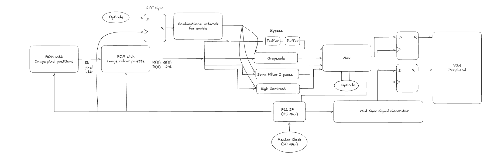

# Secure_Image_Processing
Implemented on the DE1 SoC, this project aims to design and implement an image processing pipeline with various filters and at the same time encrypt the data.

## Tools Used
- Modelsim Altera
- Intel Quartus Prime

## Architecture (Version 1)

